

  

  <a href="https://www.linkedin.com/in/baraa-melhem-17837a257">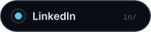</a>
  
  <a href="mailto:baraaibramelhem@gmail.com">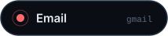</a>

  

  

  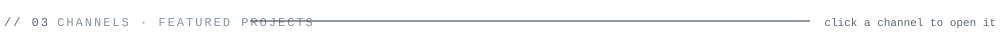

  <a href="https://github.com/Baraa-Melhem/vidpaper"></a>
  <a href="https://github.com/Baraa-Melhem/SystemWatch"></a>
  <a href="https://github.com/Baraa-Melhem/AUM2"></a>
  <a href="https://github.com/Baraa-Melhem/Recommendation-System---AI-Models"></a>

  

  Every panel on this page is a hand-built SVG, regenerated daily by <a href="scripts/build.py">scripts/build.py</a> and GitHub Actions.

